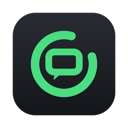

<p align="center">
  
</p>

<h1 align="center">ChatGauge</h1>

<p align="center">
  Chat with a local AI model from your macOS menu bar. Runs on your Mac with Ollama.<br>
  <sub>Native Swift · macOS 14+ · Apple silicon &amp; Intel · MIT licensed</sub>
</p>

<p align="center">
  <a href="https://paypal.me/stevencombs"></a>
  <a href="https://www.youtube.com/@retroCombs"></a>
  <a href="https://www.youtube.com/@retroCombs-tech"></a>
</p>

> **Preview.** ChatGauge 0.1 is a first test build. There is no Homebrew cask or GitHub release yet;
> build it from source (below) for now.

## What it does

- **Chat from the menu bar.** Click the ChatGauge icon or press **⌃⌥C** (changeable). Replies stream in
  from a model running on your own Mac through [Ollama](https://ollama.com). Stop, New chat and Copy are
  one click away.
- **Images.** Drag, drop or paste screenshots and photos onto the composer, the chat window or the menu bar
  icon. Vision models (such as `qwen2.5vl`) see them; ChatGauge tells you when the chosen model can't.
- **Pick your model.** Automatic picks one for your Mac's memory, or choose any installed model.
  A clear status line shows Starting, Loading model, Ready, Listening and Transcribing, so a cold model load
  never looks like a hang.
- **Models on an external drive.** Point ChatGauge at a models folder on any drive. When the drive isn't
  connected, chat pauses with a clear card and resumes when it mounts. ChatGauge never writes to a missing
  drive.
- **Gentle on memory.** When memory runs low, the next reply uses a smaller installed model and a note says
  so; it switches back when memory frees up. A reply that's already streaming is never interrupted. If a
  video editor that shares memory is open, ChatGauge mentions it once.
- **Instructions.** Standing instructions, named presets you can switch from the popover, a glossary, and a
  preview of exactly what gets sent.
- **Chats you keep.** Every chat is saved as a Markdown (or JSON) file in a folder you choose, with a history
  window you can search, rename and delete from.
- **Talk instead of type.** Hold the mic button to dictate. Speech is turned into text on your Mac with
  [whisper.cpp](https://github.com/ggml-org/whisper.cpp); nothing is sent until you press Send.
- **Stays up to date.** A daily, read-only check for new ChatGauge releases, Ollama, whisper.cpp, ffmpeg and
  your models. Choose *Notify me* (the default) or *Install automatically when idle*. Nothing installs while
  a reply is generating or while a video editor is open, and the app itself is never replaced without you.

## Requirements

- macOS 14 Sonoma or later.
- [Ollama](https://ollama.com) (`brew install ollama`) and at least one model, for example
  `ollama pull qwen2.5vl:7b`.
- Optional, for voice: `brew install whisper-cpp`.

## Settings

Eight tabs: **Model & Server** (models folder, server, model picker, keep loaded, low-memory fallback),
**Instructions**, **Chat** (where chats are saved, format, hotkey, voice), **Menu Bar** (what the icon shows,
status colors, launch at login), **Updates**, **Diagnostics** (a copyable report with your home folder
replaced by `~`), **What's New** and **About**. Settings export and import as a single JSON file.

## Privacy

Everything runs on your Mac. ChatGauge talks to Ollama on `127.0.0.1`, records audio only while you hold the
mic button and deletes the recording after transcribing it. The only network requests ChatGauge makes are
the update checks (GitHub's public releases API, Homebrew, the Ollama model registry) and downloads you
approve. No accounts, no analytics.

## How it works

- `Sources/ChatGaugeCore`: plain Foundation logic: settings, memory tiers, the Ollama client and its NDJSON
  stream parser, instructions, chat files, whisper arguments and update checks. Unit tested.
- `Sources/ChatGauge`: the menu bar app (AppKit + SwiftUI).
- ChatGauge uses an Ollama server that's already running when it can. It only unloads models it loaded
  itself, and it never force-restarts a shared server.

## Build from source

Xcode or just the Command Line Tools:

```sh
./scripts/test.sh            # unit tests
./scripts/build-app.sh       # dist/ChatGauge.app and dist/ChatGauge-<version>.zip (ad-hoc signed)
```

`ARCHS=arm64 ./scripts/build-app.sh` builds for Apple silicon only. The version comes from `VERSION`.

ChatGauge is ad-hoc signed, not notarized. After unzipping a build you downloaded, clear the quarantine flag
for this one app before the first launch:

```sh
xattr -dr com.apple.quarantine /Applications/ChatGauge.app
```

## Credits and contact

Made by **retroCombs**.
YouTube: [@retroCombs](https://www.youtube.com/@retroCombs) and
[@retroCombs-tech](https://www.youtube.com/@retroCombs-tech) ·
Contact: [retroCombs@icloud.com](mailto:retroCombs@icloud.com) ·
Tips: [PayPal](https://paypal.me/stevencombs)

ChatGauge is a community project. It isn't made or endorsed by Ollama, Alibaba (Qwen) or the whisper.cpp
authors.

## More apps from retroCombs

- [GrokGauge](https://stevencombs.github.io/GrokGauge/): your SuperGrok usage at a glance in the menu bar.

## License

MIT. See [LICENSE](LICENSE).
